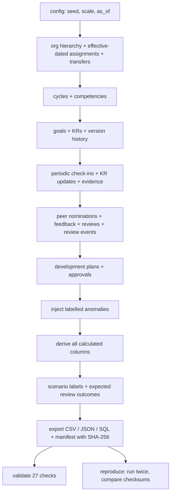

# Architecture

## Three tiers

| Tier | Technology | Responsibility |
|---|---|---|
| **Presentation** | React 18 + Vite, React Router, plain CSS (no UI kit) | Dashboards, drill-downs, forms; shows API errors verbatim so rules are visible |
| **Application** | FastAPI, Pydantic v2 | Routing, input validation, authentication (simulated), business rules, recomputation |
| **Data** | SQLAlchemy 2.0 ORM; SQLite (default) or PostgreSQL | Persistence, FK enforcement, transactional loading |

A fourth, offline component — the **data generator** — produces the dataset the app runs on.

## Request flow (a check-in)

```mermaid
sequenceDiagram
    participant UI as React UI
    participant API as FastAPI route
    participant S as goals service
    participant R as domain.rules
    participant DB as Database
    UI->>API: POST /api/goals/{id}/checkins  (X-Actor-Id)
    API->>API: Pydantic validates payload
    API->>S: submit_checkin(actor, payload)
    S->>DB: load goal, cycle, current manager (effective-dated)
    S->>S: actor is owner or manager?  cycle open?  goal approved?
    S->>R: kr_raw_progress against target in force today
    R-->>S: raw %; >100 without rationale -> 422
    S->>DB: insert check-in, KR updates, evidence (new IDs)
    S->>R: recompute KR -> goal -> review scores
    S->>DB: commit (one transaction)
    S-->>UI: 201 + new goal progress
```

## Backend layering

```
backend/app/
├── main.py          app factory: middleware, error handlers, SPA hosting, cache warm-up
├── config.py        12-factor settings from environment variables
├── db.py            engine + session; SQLite pragmas (foreign_keys=ON, WAL)
├── models.py        ORM models (parity with domain/schema.py is unit-tested)
├── schemas.py       Pydantic request models
├── deps.py          get_db, get_actor (auth), Clock (business date)
├── errors.py        DomainError hierarchy -> consistent JSON error envelope
├── loader.py        drop -> create -> bulk insert in one transaction
├── api/routes.py    thin controllers
└── services/        use cases: goals.py, reviews.py, analytics.py, common.py
```

Controllers never contain business logic; services never know about HTTP. Errors are raised as typed domain
exceptions (`Forbidden`, `Conflict`, `RuleViolation`, ...) and mapped to HTTP status codes in one place.

## Shared domain package

`domain/` is imported by the generator, the validator **and** the backend:

* `schema.py` — the data dictionary (tables, fields, types, enums, FKs, ID patterns). Drives CSV/JSON/SQL export,
  validation, the generated `docs/data_dictionary.md` and an ORM parity test.
* `rules.py` — pure functions: progress, caps, ratings, completeness, lifecycles, plan status, closed-cycle policy.
* `quality_rules.py` — the five anomaly detectors plus precision/recall evaluation; run on generated files *and* on
  the live database.

## Data generation pipeline



Key properties:

* **Parents before children** — IDs referenced by a child always exist.
* **Independent RNG stream per step** (`random.Random(f"{seed}:{step}")`).
* **Anomalies after the baseline, derivation after anomalies** — so derived values reflect the anomaly's real impact
  (e.g. a silent post-close target cut really does inflate that goal's progress).
* **Labels in a separate folder** and evaluated by joining on IDs.

## Performance notes

* Full dataset (≈250k rows) generates in ~20 s, validates in ~5 s, loads in ~3 s (SQLite) / ~8 s (PostgreSQL).
* Indexed foreign keys on all hot lookups (owner, cycle, goal, review).
* The data-quality findings are cached and invalidated by a data-version counter bumped on every committed write;
  the cache is warmed in a background thread at startup.
* List endpoints are paginated (`page`, `size` ≤ 200).

## What would change for production

* Replace `X-Actor-Id` with SSO/OIDC and map roles from the identity provider.
* Alembic migrations instead of `create_all`.
* Move detectors to a scheduled job writing to a findings table; add alerting.
* Row-level visibility (employees see their own data, managers their reporting line).
